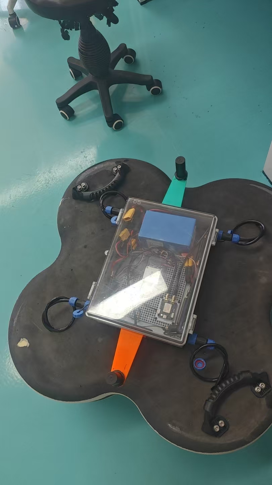

# ArduPilot Project

[](https://ardupilot.org/discord)

[](https://github.com/ArduPilot/ardupilot/actions/workflows/test_sitl_copter.yml) [](https://github.com/ArduPilot/ardupilot/actions/workflows/test_sitl_plane.yml) [](https://github.com/ArduPilot/ardupilot/actions/workflows/test_sitl_rover.yml) [](https://github.com/ArduPilot/ardupilot/actions/workflows/test_sitl_sub.yml) [](https://github.com/ArduPilot/ardupilot/actions/workflows/test_sitl_tracker.yml)

[](https://github.com/ArduPilot/ardupilot/actions/workflows/test_sitl_periph.yml) [](https://github.com/ArduPilot/ardupilot/actions/workflows/test_chibios.yml) [](https://github.com/ArduPilot/ardupilot/actions/workflows/test_linux_sbc.yml) [](https://github.com/ArduPilot/ardupilot/actions/workflows/test_replay.yml)

[](https://github.com/ArduPilot/ardupilot/actions/workflows/test_unit_tests.yml)[](https://github.com/ArduPilot/ardupilot/actions/workflows/test_size.yml)

[](https://github.com/ArduPilot/ardupilot/actions/workflows/test_environment.yml)

[](https://github.com/ArduPilot/ardupilot/actions/workflows/cygwin_build.yml) [](https://github.com/ArduPilot/ardupilot/actions/workflows/macos_build.yml)

[](https://scan.coverity.com/projects/ardupilot-ardupilot)

[](https://github.com/ArduPilot/ardupilot/actions/workflows/test_coverage.yml)

[](https://autotest.ardupilot.org/)

[](https://www.bestpractices.dev/projects/10598)


## OmniX 全向船 · 自主全向导航固件（v1.0.1）



本项目在 **ArduPilot Rover 4.8.0-dev** 基础上，为 **OmniX X 型四推进器全向船** 构建了
完整的 **自主全向导航** 方案：船体无需转向（无偏航自由度），即可向任意方向平移、
自主到达任意航点、执行两点穿梭任务。已通过水上实测验证。

---

## 一、功能介绍

| 功能 | 说明 |
|:--|:--|
| **自主全向导航（AUTO）** | 船头方向固定不动，仅靠四个（X 型 45°）推进器合力，向任意方向平滑平移到达航点 |
| **任意方向横移** | 前、后、左、右、斜向随意平移（surge + sway 合成），无需掉头或转向 |
| **两点穿梭模式（AP_Shuttle）** | 按 QGC 的 DO_REPOSITION 指令在两点间自动往返，到点悬停，支持手动接管检测 |
| **世界系直驱导航** | 全程跟随 SCurve 的世界系期望速度（位置误差 P 纠偏 + 平滑加减速），到达判定与原生一致 |
| **双天线 RTK 航向（无罗盘）** | UM982 双天线提供精确航向（GPS1_MB 配置），摆脱对磁罗盘的依赖 |
| **SITL 仿真支持** | 内置 OmniX 船的动力学仿真模型（sim rover-omnix），可在无硬件时验证整套逻辑 |

---

## 二、与原版 OmniX 船体的对比（重点不同）

> 我们针对自己的船体做了大量针对性修改，与原版 OmniX 有本质区别：

| 对比项 | 原版 OmniX | **本项目 OmniX 船** |
|:--|:--|:--|
| **运动方式** | 原地转向 + 前进（转向依赖偏航） | **不转向！船头固定，全靠全向平移** |
| **偏航自由度** | 有（可自旋，靠 pivot 原地转向） | **无**（径向推进器力矩相互抵消，不能自旋） |
| **航向来源** | 磁罗盘 | **UM982 双天线 RTK 航向**（无磁罗盘） |
| **导航驱动力** | 航向 + 油门（L1/转向控制） | **世界系速度直驱**（surge/sway 分解，绕过转向） |
| **到达判定** | 转弯接近 + 半径 | **原生 SCurve reached_destination**（无需 hack） |
| **pivot 转向** | 可用（WP_PIVOT_ANGLE） | **必须禁用！**（WP_PIVOT_ANGLE=0，否则 SCurve 被冻结 → 零推力） |
| **任务形态** | 通用航点 | 航点 + **两点穿梭专用状态机** |

---

## 三、我们做了什么修改

在 ArduPilot Rover 基础上，为支撑"无偏航全向船自主导航"，我们对以下部分做了**大量修改**：

### 1. 核心导航 — `Rover/mode.cpp`
新增 `omni_translate_enabled()` 分支（`navigate_to_waypoint()`）：
- 直接读取 **`g2.pos_control.get_vel_target()`**（SCurve 世界系期望速度 + 位置 P 纠偏），
  按比例映射为 `set_throttle` / `set_lateral` 驱动四推进器；
- 用实时航向（`ahrs.yaw_sensor`）把世界系速度旋转到船体系分量（surge/sway）；
- 到达判定统一用**原生 `wp_nav.reached_destination()`**，彻底告别 V4/V5 的手写停止 hack。

### 2. 位置控制器扩展 — `libraries/APM_Control/AR_PosControl.h`
新增 **`get_vel_target()`** 访问器，供全向船读取原生位置控制器的世界系目标速度。
> 这是让 omni 船能用上 ArduPilot 原生 SCurve 位置控制的唯一桥接改动。

### 3. 全新两点穿梭模式 — `Rover/AP_Shuttle.{h,cpp}`
- 状态机：`IDLE / TASK / MOVING / HOVER / MANUAL_MODE`；
- `GCS_MAVLink_Rover.cpp` 中 `handle_command_int_do_reposition()` 对接：
  穿梭校验 → 进入 GUIDED → 设置目标点/速度 → 到点悬停 → 手动接管监测。

### 4. 参数与集成
- 新增 `SHUTTLE_` 参数组（`Parameters.cpp/h`）；
- `Rover.cpp/h`、`system.cpp`：模式切换钩子 + 主循环 `shuttle.update()`；
- `OMNI_YAW_HOLD`、`OMNI_LAT_PCT` 等参数中文注释与行为约束。

### 5. SITL 仿真 — `libraries/SITL/SIM_Rover.cpp`
- 新增 **OmniX 4 推进器船动力学模型**（`update_omnix()`）：正/逆混合、偏航惯性、
  可选偏航漂移（`rover-omnix:yawdrift=N`）；
- 配套真机参数文件：`Tools/autotest/default_params/rover-omnix-real.parm`。

---

## 四、代码结构速览

```
Rover/mode.cpp                        全向平移导航（omni_translate_enabled 分支）
Rover/AP_Shuttle.h / .cpp             两点穿梭模式状态机
Rover/GCS_MAVLink_Rover.cpp           DO_REPOSITION 穿梭指令处理
libraries/APM_Control/AR_PosControl.h get_vel_target() 访问器
libraries/SITL/SIM_Rover.cpp          OmniX 船 SITL 动力学模型
Tools/autotest/default_params/rover-omnix-real.parm   真机参数
```

## 五、构建 & 运行

```bash
# 真机固件（CUAVv5）
./waf configure --board CUAVv5
./waf build --targets bin/ardurover

# SITL 仿真
./waf configure --board sitl
./waf build --targets bin/ardurover
build/sitl/bin/ardurover --model rover-omnix --home 31.230562,120.637009,0,0
```

---

## 验证状态

- ✅ **v1.0.1（2026-10-16）水上实测通过**：
  - 两航点直线航行任务 ✓
  - 三航点 C 型运动任务 ✓
- ✅ SITL 仿真全流程验证
- 标签：`v1.0.1-自主全向导航已验证`

---

*基于 [ArduPilot](https://github.com/ArduPilot/ardupilot)（GPLv3 协议）的定制分支。*
