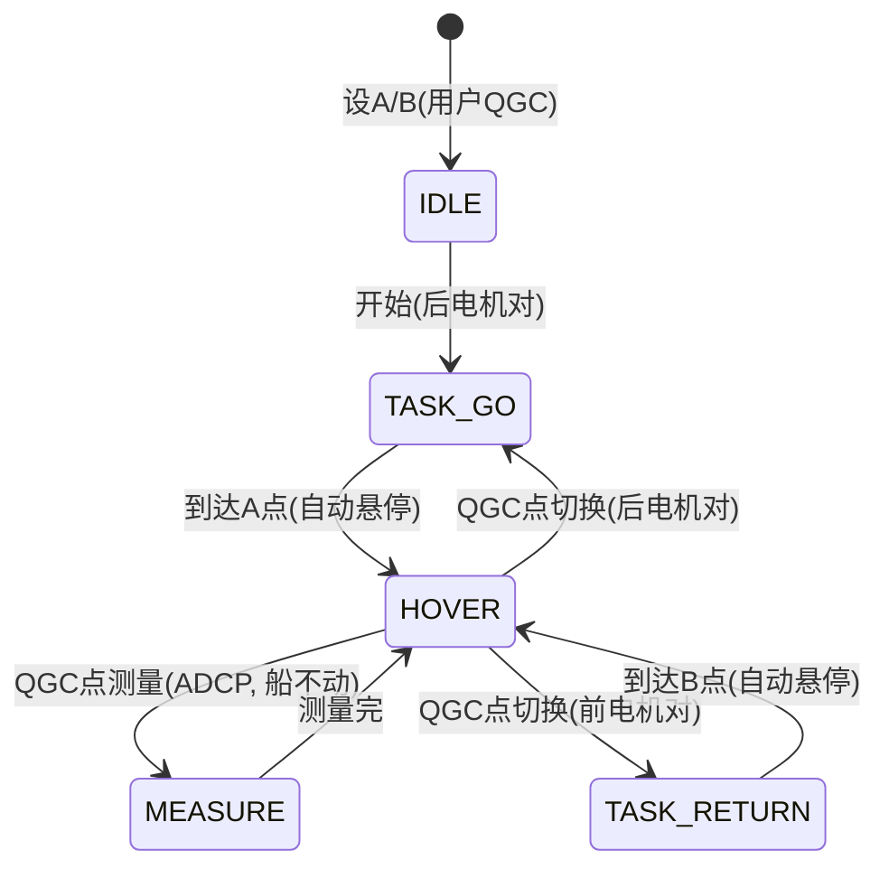

# OmniX 差速穿梭改造方案（设计文档）

> 本文档记录 2026-10-22 与用户确认的完整改造需求与实现设计。
> 任何后续代码修改必须先读本文件 + `CODE_STYLE.md`。

## 一、系统总需求

AB 点来回移动的数据测量船（船体中央装 ADCP）：
- **整体**：X 型布局，4 个电机 45° 朝向四角外侧，喷气动力朝 X 四角外侧
- **手动模式**：只用后两电机，差速控制（前进/后退/左右转），**禁用横移**
- **自动模式**：与手动一致，差速船，转向前进导航，**禁用横移**
- **穿梭模式**：前后两对电机交替使用，A-B 间直线来回，到点自动悬停
- **悬停模式**：唯一需要同时启动 4 电机的场景，航点/当前位置定点悬停
- **硬件规划**：后续更换厘米级 GPS、不限功率电调（提升差速转弯半径）

## 二、电机命名约定

| 索引 | 通道 | 位置 | OmniX 系数(T/S/L) |
|---|---|---|---|
| M0 | SERVO1(33) | 前左 | +1 / -1 / -1 |
| M1 | SERVO2(34) | 前右 | +1 / -1 / +1 |
| M2 | SERVO3(35) | 后左 | +1 / +1 / -1 |
| M3 | SERVO4(36) | 后右 | +1 / +1 / +1 |

- 前电机对 = M0/M1（穿梭回程 B→A 用，正转倒着走）
- 后电机对 = M2/M3（手动/自动/穿梭去程 A→B 用，差速前进）

## 三、各模式电机使用表

| 模式 | 电机对 | 驱动方式 | 横移 |
|---|---|---|---|
| 手动 MANUAL | 后 M2/M3 | 差速（前进/后退/转向） | 禁用 |
| 自动 AUTO | 后 M2/M3 | 差速 + L1 转向导航 | 禁用 |
| 穿梭 A→B | 后 M2/M3 | 差速直行 + 直线纠偏 | 禁用 |
| 穿梭 B→A | 前 M0/M1 | 差速倒车 + 直线纠偏 | 禁用 |
| 悬停 LOITER | 全 M0~M3 | 全向位置保持 | 启用 |

## 四、穿梭状态机（QGC 手动控制测量/切换）



关键点：
- 去程 A→B：后电机对差速推进；回程 B→A：前电机对正转倒着开，**不调头**
- 到点自动悬停（停稳在航点）；悬停中 QGC 手动命令：测量（船不动）/ 切换（换电机对出发）
- 切换/测量命令均为 QGC 手动控制

## 五、差速公式（复刻原生 skid steering）

```
scaled_throttle = throttle * 0.01      # -1 ~ +1
scaled_steering = steering / 4500.0    # -1 ~ +1
后电机对(去程): M2(后左) = scaled_thr + scaled_steer
                 M3(后右) = scaled_thr - scaled_steer
前电机对(回程): M0(前左) = scaled_thr + scaled_steer
                 M1(前右) = scaled_thr - scaled_steer
输出: ×100 百分比, 未激活电机发 TRIM(1500)
```

- steering 正 = 顺时针（右转）：左侧电机快、右侧慢 ✅ 与原版一致
- 差速船没有横移能力，lateral 通道在手动/自动/穿梭时忽略（置 0）

## 六、实现设计（落在当前 Ardupilot_OMNI 代码上）

**核心：AP_MotorsUGV 新增"电机对 + 差速输出路径"，与原有全向路径并存**

1. `AP_MotorsUGV` 新增枚举 `MotorPair { ALL, REAR, FRONT }`，成员 `_motor_pair`（默认 ALL）
2. `set_motor_pair(pair)` / `get_motor_pair()`
3. `output_omni()` 按 `_motor_pair` 分支：
   - ALL：现有全向混控（不变）
   - REAR：M2/M3 差速，M0/M1 发 TRIM
   - FRONT：M0/M1 差速，M2/M3 发 TRIM
4. `omni_translate_enabled()` 改为仅 `_motor_pair == ALL` 时返回 true
   → 手动/自动/穿梭自动落到标准差速导航路径，无需改导航器
5. 手动/自动模式 `set_lateral(0)` 禁用横移
6. 穿梭 `begin_leg()`：目标近 A → REAR，近 B → FRONT；到达 HOVER → ALL
7. 悬停 LOITER 用 ALL（全向）

## 七、实施步骤（增量，不重写）

| 步骤 | 内容 | 状态 |
|---|---|---|
| 1 | AP_MotorsUGV 加电机对 + 差速输出路径 | ✅ 完成 |
| 2 | 手动模式：REAR 差速 + 禁横移 | ✅ 完成 |
| 3 | 自动模式：REAR 差速 + L1 导航 + 禁横移 | 待做 |
| 4 | 穿梭：A→B REAR / B→A FRONT + 直线纠偏 | 待做 |
| 5 | 悬停：切回 ALL 全向 | 待做 |
| 6 | 编译 + SITL 回归验证 | 待用户授权 |

## 八、重要约束（来自 CODE_STYLE.md）

- **严禁擅自重写**：优先在原代码基础上局部修改；废弃功能需提前汇报审批
- **严禁擅自编译/烧录**：只在用户明确授权后执行
- 每次改代码前必读 CODE_STYLE.md + 本文档
